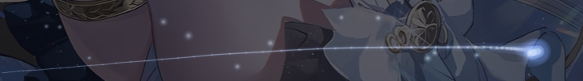

# DSH 尤诺主题 · 桌面端（DeepSeek Iuno Skin for Desktop）



把 **DeepSeek Harness 桌面端**（Electron 客户端）的界面铺上指定的尤诺立绘作背景，
UI 保持纤细极简——侧栏一缕玻璃、按钮一格金边、发送一弯月。

本包是 web 版 [`dsh-iuno-widget`](../DeepSeek-Iuno-Widget) 的**桌面端适配版**：
视觉与功能一致（壁纸、金色发丝线、氛围星尘、鼠标流光、右下角桌宠 + 右键小面板、
壁纸亮度滑杆、更换背景、余额小签），但**注入通道换成了桌面端唯一生效的那条**。

**v1.7.0 是完整的「主题级体验」**，向 shorekeeper 主题看齐：

- **侧栏入口**：左侧导航多一行「尤诺主题」（月牙细线图标），点开在**主区**打开主题设置页；
  也可按 **Alt+Y** 调出同一套浮层面板，或右键桌宠 →「主题」→ 设置…。
- **静态壁纸**：背景固定为静态立绘，**不播放动态 loop / 不做微动效**（按需求）；
  亮度、压暗、模糊、界面透明度、星尘浓度都可调。
- **背景清透度修正**：DSH 0.2.2 浅色模式下除 `body` / `.frame` 外，会话区还有一层
  `--dsw-alias-bg-base`（0.58）在盖白 —— 已打通，浅色下立绘清晰可见。
- **入场动画**（默认关闭）：PV（18.1s）/ 抽卡长版（15.1s）/ 抽卡短版（7.1s）三种片头，
  **保留原视频声音**、音量可调。
- **线稿过渡**（v1.7.0，B+C）：**开场**按当前影片首帧慢慢描线 → 淡入正片；
  **片尾**影片压黑 → 默认壁纸线稿慢慢描出 → 壁纸淡入。**纯线稿、无粒子**，默认慢速。

详见 [静态壁纸与显示](#静态壁纸与显示) / [主题设置](#主题设置侧栏--主区--浮层) /
[线稿过渡](#线稿过渡开场首帧--片尾壁纸v170) / [入场动画](#入场动画v170默认关闭)。

> 桌面端专用。web 端请继续用 `dsh-iuno-widget`：两者的 head 注入位置不同
> （web 把注入行插在 `<head>` 之后，桌面端 append 到 `</head>` 之前），
> 皮肤样式在 web 端会被应用自身 CSS 反压。

## 为什么 web 版在桌面端不生效

| | web（`dsh web`） | 桌面端（Electron） |
| --- | --- | --- |
| 页面来源 | 宿主 HTTP 服务渲染 `index.html`（`dsh-host-frontend-static` → `webServer.renderIndex()`） | 自定义协议 `dsh-app://app/`，`index.html` 由 Electron 自己发（`serveWebDocument`） |
| 注入通道 | 结构化注入行 **+** `webServer.tapIndex()` 拼字符串 | 只有**结构化注入行**：宿主 `webServer.collectIndexInjections()` 的行经 IPC 交给前端，前端启动 Cordis 前逐行应用（`global` / `script` / `script-src` / `style` / `html`） |
| `tapIndex` | 生效 | **完全不生效**（不读、不渲染）→ 旧版的 `<link>` / `<script>` 全部丢失 |
| 插件路由 | 直接访问 `http://127.0.0.1:3080/dsh-iuno/*` | Electron 把 `dsh-app://app/dsh-iuno/*` 转发给宿主 HTTP 服务并代挂鉴权 cookie，行为等价 |
| 端口 | 默认 3080 | 固定 19387（`--no-open --port 19387`） |

所以本包**只用结构化注入行**：

- `html` 行 —— `<style id="yn-skin-css-…">` 内联 `theme.css` / `pet.css` / `desktop.css` / `intro.css` / `intro-art.css` / `theme-settings.css`，进页面即生效、不闪白；
- `script` 行 —— 一小段刷新器：页面起来后再从 `/dsh-iuno/*.css` 拉一次最新文本覆盖内联副本，
  于是「改 CSS → 刷新页面」这个工作流在桌面端依然成立，不必重启应用；
  入场开启时还会多一条首帧遮罩 `script` 行（防白闪，只在开启且非刷新时下发）；
- `script-src` 行 —— `theme.js` / `pet.js` / `trail.js` / `intro-art.js` / `intro.js` / `theme-settings.js`，前端会 `await` 其加载完成再启动界面。

其余全部沿用 web 版：路由仍是 `webServer.register`，桌面端转发过来的路径与页面同源
（`dsh-app://app/dsh-iuno/…`），因此不会触发 CORS 预检，上传壁纸、写配置与 web 版一致。

## 桌面端额外适配

- **余额小签读登录账号**：桌面端通常用 DeepSeek 账号登录（`deepseek-account`），
  没有 `DEEPSEEK_API_KEY`。`/dsh-iuno/balance.json` 现在优先调
  `ctx.deepseekAccount.getBalance()` 读账号钱包（含赠送余额），未登录时才回退
  本地 API key + 官方 `/user/balance`。
- **配置落在桌面 profile**：写入 `~/.dsh/profiles/desktop/`（各 profile 互不干扰），
  读取顺序为 `profiles/desktop` → `~/.dsh` → `profiles/web`，
  所以首次在桌面端运行会继承 web 版已设的亮度 / 自定义壁纸。
- **窗口拖拽（皮肤里绝不写 `-webkit-app-region`）**：Windows 的拖拽来自
  `titleBarStyle:'hidden'` + `titleBarOverlay` 提供的原生拖拽条（顶部 40px），
  而 Chromium 会把显式声明 `no-drag` 的元素从可拖拽区里**减掉**。壁纸层是
  `position:fixed; inset:0`，一旦声明 `no-drag` 就正好盖掉整条标题栏 —— 窗口再也拖不动
  （v1.0.0 的 bug，v1.1.1 修）。所以 `lib/desktop.css` 里一条 `app-region` 都不写；
  图层不吃事件靠 `pointer-events:none`（壁纸 / 星尘 / 流光），桌宠在右下角、
  不在拖拽条范围内。macOS 侧应用自己会处理 `body>:not(#root){-webkit-app-region:no-drag}`。
- **原生标题栏**：Windows 顶部 40px 由 `titleBarOverlay` 绘制（颜色在创建窗口时定为
  应用自身 chrome 色 `#1b1b1c`），插件无法着色，这一段本来也看不见壁纸；
  星尘因此从标题栏下沿开始画。

## 静态壁纸与显示

背景固定为**静态立绘**（`assets/iuno-wall.jpg`，2560×1440）：不播放动态 loop、不做呼吸微动效
（v1.4.0 按需求移除了动态壁纸层，同时删掉了 9.7MB 的 `loop.mp4` 素材）。

背景与界面的显示参数都可实时调（CSS 变量）：

| 设置项 | 变量 | 默认 | 说明 |
| --- | --- | --- | --- |
| 壁纸亮度 | `--yn-wall-brightness` | 0.86 | 作用在壁纸层 |
| 背景压暗 | `--yn-wall-dim` | 0 | 0–50%，只压背景不影响文字 |
| 背景模糊 | `--yn-wall-blur` | 0 | 0–16px，只作用于背景层 |
| 浅色纸面 | `--yn-veil-light` | 0.08 | **v1.19**：浅色内容区月白纸面的强度（0→纸面 0.42，40%→0.62）。越高文字越稳、壁纸越淡 |
| 深色轻纱 | `--yn-veil-dark` | 0.42 | 深色模式的暗纱，越低背景越清晰 |
| 界面透明度 | `--yn-ui-alpha` | 1 | 侧栏/输入卡玻璃的不透明度系数（60–120%） |
| 星尘浓度 | `--yn-ambience` | 1 | 0% 关闭氛围层 |

自定义背景：设置 → 背景 →「更换背景…」（≤20MB）；换回默认用「恢复默认背景」。

## 主题设置（侧栏 / 主区 / 浮层）

入口有三个，打开的是同一套设置：

1. **左侧导航「尤诺主题」一行**（v1.4.0 新增，月牙细线图标）→ 在**主区**打开设置页；
   这是 client 插件（`lib/client.js`）注册的 `main` + `sidebar.panellist` 槽，点「新会话」即可离开；
2. 任意页面按 **Alt+Y** → 居中玻璃浮层面板；
3. 右键桌宠 →「主题」→ 设置… → 浮层面板。

| tab | 能改什么 |
| --- | --- |
| 启动动画 | 开关、播放时机（每次启动 / 仅首次）、影片（PV / 抽卡 / 抽卡短）、开场/片尾线稿开关、描线速度、片头音量、重播 |
| 背景 | 静态壁纸说明；壁纸亮度、背景压暗、背景模糊；更换 / 恢复默认背景 |
| 显示 | 浅色纸面（壁纸清晰 ↔ 文字可读的平衡）、深色轻纱、界面透明度、星尘浓度 |
| 关于 | v1.6.0、侧栏/Alt+Y 说明、恢复全部默认 |

- 滑块先本地生效（`window.__ynApplyLook` → CSS 变量），300ms 防抖后写服务端；
  所有配置落在 `~/.dsh/profiles/desktop/.dshy-size.json`，重启后保留。
- 浮层 `z-index: 2147483100`（星尘之上、入场层之下），深浅色各一套配色；
  主区页面模式复用同一套 DOM（`window.__ynMountSettingsPage(host)`），不会出现两套设置实现。
- 字段：`introEnabled` `introMode` `introVideo` `wallBrightness` `wallDim`
  `wallBlur` `veilLight` `veilDark` `uiAlpha` `ambience`（旧的 `bgMode`/`motion` 已忽略）。

## 背景清透度修正（v1.3.0）

DSH 0.2.2 浅色模式下其实有**三层**白底叠在壁纸上：

1. `body` 的 `background-color: var(--dsw-alias-bg-base)`（0.58）→ 已置透明；
2. 布局 `.frame` 的一层底色（0.58）→ 改成可调轻纱 `--yn-veil-light`，默认 **0.08**；
3. **会话区（centerCol）自己又铺了一层 `--dsw-alias-bg-base`（0.58）** —— 这是上一版
   修完仍觉得「背景发白」的元凶，现在把会话区的 token 降到 `--yn-veil-light × 0.75`
   （默认 ≈0.06），菜单 / 弹层使用的 `--dsw-specific-menu` 等不受影响。

结果：浅色下立绘基本以原始对比度呈现（总白纱 ≈0.14 → 之前是 ~0.75），
深色则走 `--yn-veil-dark`（默认 0.42）。设置面板「显示 → 浅色轻纱」可 0–40% 无级调；
调到 0 完全无纱，深色文字可读性会下降，按个人口味取舍。

> **v1.19.0 修正（2026-11-12）**：上面这条"极薄白纱 + 字形光晕"的路线在浅色下
> 会**把字边糊掉**（用户反馈"字看着不舒服"）。v1.19 改成"月白纸面"：浅色内容区
> （centerCol）铺一张半透明纸（0.42→0.62，由「浅色纸面」滑杆驱动），**取消浅色下
> 所有 text-shadow 光晕**；壁纸层白纱降到 0.16。壁纸仍从纸面下透出来（默认纸面 0.46
> ≈ 壁纸可见 54%），文字直接落在干净底上。深色模式不变。
> 结论：**"背景可见"与"文字可读"不应该用字形光晕去换**——光晕是模糊源，不是对比度源。

## 线稿过渡：开场首帧 + 片尾壁纸（v1.7.0）

按反馈去掉粒子拟合，只做**纯线稿**，默认**慢速**：

1. **开场（B）**：选中的影片先不播，先按它的**第一帧**慢慢描线（从中心向外逐笔生长），
   画完后线稿淡出、同一帧的视频起播 —— 线稿与视频首帧同构图，无跳变。
2. **片尾（C）**：影片播完 → 末帧压到近黑 → 按**默认壁纸**慢慢描出线稿 →
   壁纸淡入 → 整层淡出回到真实界面。

| 项 | 说明 |
| --- | --- |
| 资产 | `assets/intro/art/first-pv.json`（10 笔）/ `first-gacha.json`（140 笔）/ `first-gacha-short.json`（78 笔）/ `end-wall.json`（248 笔，去脸部/五官区） |
| 实现 | `lib/intro-art.js`（Canvas2D 逐笔生长）+ `lib/intro-art.css`；无粒子、无 WebGL |
| 时长（慢/中/快） | 开场 6.0 / 4.2 / 2.8s；片尾 5.0 / 3.6 / 2.4s |
| 开关 | 启动动画 →「开场：首帧线稿」「片尾：壁纸线稿」；关掉对应段落直接跳过 |
| 速度 | `lineartSpeed`: `slow`（默认）/ `mid` / `fast` |

线稿提取脚本/预览在 `../DeepSeek-Iuno-Intro/preview/`（`make-end-lineart.py`、`make-lineart.py`）。

## 入场动画（v1.7.0，默认关闭）

应用启动后先铺深空遮罩（盖住原生加载页，防白闪），然后按当前影片首帧描线（B），
线稿淡出后**直接播视频**（带原声、可跳过）：`pv`（18.1s）、`gacha` 抽卡长版（15.1s）、
`gacha-short` 抽卡短版（7.1s）。视频播完后走片尾壁纸线稿（C），再进静态壁纸 / 真实界面。
点击任意处 / `ESC` / 右下角「跳过」可立即结束。

**开关**：左侧「尤诺主题」页 → 启动动画 tab；或右键桌宠 →「入场动画」→ 开关/选片/重播。

| 行为 | 说明 |
| --- | --- |
| 默认 | **关闭**（新装不会突然多一段片头） |
| 开启后 | **下次应用启动**才自动播（首帧遮罩行由宿主按配置在启动时下发） |
| 播放时机 | `every` 每次启动 / `once` 仅首次（localStorage 记标记，手动重播不受限） |
| 页面刷新（F5） | **不重播**，也不会闪黑（遮罩行检测到 reload 会跳过） |
| 手动「重播」 | 随时可看，不受开关限制、不用重启 |

**内置预设**（影片可用性由 `assets/intro/` 下文件是否存在自动决定）：

| id | 面板名 | 说明 |
| --- | --- | --- |
| `pv` | PV | 1920×886 / 30fps / 18.1s / **AAC 音轨** / 首帧线稿 10 笔 |
| `gacha` | 抽卡 | 1920×1200 / 60fps / **15.07s 长版** / **AAC 音轨** / 12.3MB / 首帧线稿 140 笔 |
| `gacha-short` | 抽卡·短 | 1920×1200 / 60fps / **7.1s 短版** / **AAC 音轨** / 6.9MB / 首帧线稿 78 笔 |

**声音**：三份视频都保留了音轨（源音频削峰后 AAC 编码，TP −1.1～−1.5 dBFS）；
音量设置 `introVolume` 0–100%（默认 60%，0 = 静音）。若系统拦截「有声自动播放」，
会先静音起播，用户第一次点击后再恢复声音（音量设置不变）。

**加新片**：

1. 把 `<id>.mp4` 与 `<id>-poster.jpg` 放进 `assets/intro/`（可带 AAC 音轨，
   H.264 / yuv420p / `-movflags +faststart`）；
2. 在 `lib/index.js` 的 `INTRO_PRESETS` 里加一条 `{ label, file, poster, art, start, end }`
   （`art` 指向 `assets/intro/art/` 下的首帧线稿 JSON，可留空）；
3. 重启应用（预设表与注入表都是宿主启动时读的；只换视频文件则刷新页面 +「重播」即可）。

**配置**：`~/.dsh/profiles/desktop/.dshy-size.json`：

```json
{ "introEnabled": false, "introMode": "every", "introVideo": "pv",
  "introVolume": 0.6, "startLineartEnabled": true, "endLineartEnabled": true,
  "lineartSpeed": "slow" }
```

**实现与边界**：

- 首帧防闪：开启时宿主注入一条内联 `script` 行 + `intro.css` 的 boot 遮罩，
  在应用首帧前把整页压成深空色；`reload` 时不下发，F5 不闪黑。
- 开场线稿画在海报之上（海报=视频首帧，压暗），画完线稿淡出 + 视频起播，
  所以「线稿 → 正片」是同一构图；线稿本身只画在暗底上，不叠加彩色粒子。
- 片尾线稿：去掉脸部 12 笔/五官区，避免「吓人脸」；人脸留白交给壁纸淡入时补上。
- **自定义壁纸**时片尾仍按默认立绘线稿过渡，属预期边界。
- **Windows 顶部 40px 是原生标题栏按钮区，盖不住**；片头从标题栏下沿开始，属预期边界。
- 入场层 z-index `2147483300`（高于星尘 `2147483000`、设置面板 `2147483100`、桌宠 `2147482000`），
  且图层绝不写 `-webkit-app-region`（会吃掉窗口拖拽区）。
- 影片路由为 `/dsh-iuno/intro/<id>.mp4`，只下发 `INTRO_PRESETS` 白名单里的文件名（防目录穿越），
  支持 `Range` 请求；线稿 JSON 走 `/dsh-iuno/intro/art/*` 白名单。

## 安装（桌面 profile 由 Electron 应用独占管理）

桌面端 profile 不能用普通 `dsh --profile desktop` 启动，插件也得用**应用自带的 CLI** 装：

- **方式一：在这个桌面应用里让 Agent 装（推荐）**
  > 请把 `link:<本包绝对路径>` 安装到 desktop profile（plugin_manager → install_bundle）。

- **方式二：手工调用应用自带的 CLI**
  ```powershell
  $exe  = "C:\Users\<你>\AppData\Local\Programs\DeepSeek Harness\DeepSeek Harness.exe"
  $cli  = "C:\Users\<你>\AppData\Local\Programs\DeepSeek Harness\resources\app.asar\dsh\node_modules\@deepseek-ai\dsh-desktop-host\lib\cli.js"
  $env:ELECTRON_RUN_AS_NODE = "1"
  & $exe $cli plugin --profile desktop add link:D:\Programing\kllmtmp\DeepSeek-Iuno-Widget-Desktop
  ```
  （`link:` 后紧跟绝对路径，中间不要空格；不要写成 `link:.\<子目录>`。）

装完 **必须完全退出并重开 DeepSeek Harness**：注入表是宿主启动时收集、由 Electron
一次性交给渲染器的，热加载的插件不会出现在当前窗口里。

## 生效与调试

- **重启应用**后界面即换肤；之后：
  - 改 `lib/pet.js`、`lib/theme.js`、`lib/trail.js`、`lib/intro.js`、`lib/theme-settings.js`
    → 刷新页面（`Ctrl+R`）即可（脚本走 `script-src` 行，`no-store`）；
  - 改 `lib/*.css` → 刷新页面即可（注入的是内联副本，页面加载后会被刷新器覆盖成最新文本）；
  - 换 `assets/intro/<id>.mp4` / 海报 → 刷新页面后点设置页「重播」即可看到（路由每次读盘）。
- **改宿主逻辑（`lib/index.js` 的路由 / 余额 / 读写 / 入场预设表）、`cordis.patch.yml`、
  `package.json`（含 `dsh.client` / `exports`）、`lib/client.js`、新增资源路由** →
  需要重启应用：宿主插件是进程内 ESM、client bundle 由 client-modules 在启动时登记。
- 壁纸亮度、氛围浓度、自定义壁纸、入场设置、显示参数都写进
  `~/.dsh/profiles/desktop/.dshy-size.json` 和 `.dshy-wall-custom.bin`；
  左侧「尤诺主题」/ Alt+Y / 右键桌宠都能打开设置。

## 选择器约定（改 CSS 前必读）

DSH 前端不给组件稳定类名，只有「哈希 + 可读名」，而且当前构建里**两种写法并存**：

```css
._2H3hWW_newSession        /* 旧命名：前导下划线 */
.Dc7zOa_composerStack      /* 新命名：无前导下划线 */
```

哈希与可读名之间总有一个下划线，所以皮肤统一用 `[class*="_可读名"]`（两种命名都命中）。
坑在于：**前缀相同的内部变体会被一起命中**——例如
`[class*="_newSession"]` 会同时命中按钮内部的 `newSessionContent`（于是边框和月牙被套两层，
表现为按钮里出现两个半月牙），所以外层规则必须用 `:not()` 排掉内部变体：

| 目标 | 规则写法 |
| --- | --- |
| 新会话按钮 | `[class*="_newSession"]:not([class*="Label"]):not([class*="Content"]):not([class*="Shortcut"])` |
| 发送按钮 | `[class*="_primary"]:not([class*="Button"]):not([class*="Option"]):not([class*="Item"])` |
| 输入卡 | `[class*="_card"]:not([class*="Workspace"]):not([class*="Icon"]):not([class*="Content"])` |
| 图标按钮 | `[class*="_iconButton"]:not([class*="Danger"])` |
| 药丸触发器 | `[class*="_trigger"]:not([class*="Label"]):not([class*="Icon"]):not([class*="Effort"])` |
| 起始页标题文字 | `<span>` 自己没有类名，只能按结构取：`[class*="titleGroup"] > span:first-child` |

`lib/theme.css` 顶部的第 0 节把这份约定写进了文件本身，改之前先看一眼。

## 修订记录

- **v1.22.0**
  - 欢迎字回到开场全黑时出现（粒子前），英文副标题改 Cinzel（打包 TTF）。
  - 显示页参数拖动保留设置面板实时预览；只有背景页滑杆进入“只剩参数条+背景”模式。
- **v1.21.0**
  - 浅色鼠标流光改墨金/香槟配色，并在真实指针处加高对比细环；浅色背景上光标更清楚。
  - 按住任意设置滑杆只显示「背景 + 当前参数条」，松开立即恢复设置台。
- **v1.20.0**
  - 跳过入场也会启动抽卡循环壁纸（prelude / playing 跳过都处理）。
  - 移除额外 4px 壁纸模糊；背景模糊只由设置控制。
  - 背景 tab 新增「全屏预览背景」：只显示当前背景，点击/ESC 返回。
- **v1.19.0**
  - **浅色文字可读性重做（月白纸面）**：v1.18 的做法是"不铺任何层、只给每个字形加
    白色 text-shadow 光晕"——用户反馈「浅色下，字看着有点不舒服」：白晕把字边糊掉，
    小字尤其发虚。v1.19 改为浅色内容区（centerCol）铺一张半透明月白纸，
    **删除浅色下所有字形阴影**；纸面强度并入「浅色纸面」滑杆（原「浅色轻纱」），
    壁纸层白纱 0.26→0.16（可读性交给纸面，白纱只压花哨区域）。
    深色模式不变（白字 + 暗投影本就成立）。
  - 验证：临时 desktop profile 主机 + CDP 无头截图（1898×1046，插件页/会话页），
    浅色前后对照见 `../DeepSeek-Iuno-Intro/verify/shots/v29-*`；深色零改动对照。
- **v1.19.0**
  - 浅色去掉白色 text-shadow 光晕（字形发糊的原因），内容区加适度白纱；
    壁纸仍可见、文字更舒服；深色仅保留轻微暗影。
- **v1.18.0**
  - 按“背景看不见”反馈回滚重纱：仅对壁纸层加 `blur(4px)` + 低透明底纱，
    文字只加 text-shadow，不再覆盖 UI；背景恢复可见，文字保持可读。
- **v1.17.0**
  - 去掉 backdrop-filter（会压住内容）；壁纸层低透明底纱 + `.frame`/centerCol 高透明白/暗纱，
    浅色文字清晰可读，壁纸仍透出。
- **v1.16.0**
  - 回滚线稿扫描开场，恢复原粒子开场（PV 聚月 / 抽卡四角拟合），粒子轨迹更连续顺滑；
    欢迎字回原位置。
  - 浅色/暗色 UI 可读性：内容区白色/深色轻纱 + `backdrop-filter: blur(6px)`；
    `veilLight` 默认 0.08→0.18。
- **v1.15.0**
  - 1A+2B：欢迎字开头整体同进同出 → 首帧线稿自适应中间内容区域横向扫描
    → 原粒子（PV 聚月 / 抽卡四角拟合）水纹拖尾 → 淡入影片。
- **v1.14.0**
  - 开场重做：欢迎字整体同时淡入/淡出 → 首帧线稿横向扫描（只描中间约 1/3 轮廓）
    → 水纹粒子拖尾 → 淡入影片；三种影片通用。
- **v1.13.0**
  - 暗色模式背景提亮：body 暗纱 `veilDark×0.70`、frame/centerCol `veilDark×0.55`，
    `veilDark` 默认 0.42→0.28；旧配置 0.42 也会明显变亮。
- **v1.12.0**
  - 修复 PV 截短：恢复完整 18.533s 视频 / 18.517s 音频；白闪前的干净末帧冻结
    代替白闪，语音播完才过渡到壁纸（不再提前 0.4s 切）。
- **v1.11.0**
  - 性能：粒子按颜色/透明度批量合成 path（fill 从数万次降到 ~70 次/帧）；
    内部渲染分辨率降到 CSS 的 0.6–0.85；月亮 1 万、拟合 9000 粒子；
    无头 Electron 实测月亮 59fps、拟合 61fps。
- **v1.10.0**
  - 粒子更细腻：月亮 1.2 万 + 四角拟合 3 万；每颗粒子 2–3 段拖尾、微切向漂移、亮度分层。
  - 欢迎文字：中文「华文行楷」、英文 **Italianno** 意大利花体（内置
    `assets/intro/fonts/Italianno-Regular.ttf`），字号 36–54px + 金色高光流动。
- **v1.9.0**
  - **PV 开场**：黑屏 → 上下粒子各旋一圈聚成月亮 →「欢迎回来，空白」→ 淡入 PV。
  - **抽卡长/短版开场**：四角粒子逆时针漩涡，拟合各影片首帧；随后淡入正片。
  - **欢迎文字**：金色/月白渐变 + 流动高光 + 双层光晕。
  - **抽卡片尾循环壁纸**：`assets/bg/loop.mp4`（1600×1000/30fps/1.74MB，无音轨）；
    抽卡长/短版播完才启动，入场期间暂停；`loopWallpaperEnabled` 默认 true，设置可关。
  - 声音默认静音（`introVolume` 默认 0）。
- **v1.8.0**
  - 粒子聚月开场 + 片尾淡出到壁纸；移除线稿与「动态定格」；声音默认静音。
- **v1.7.0**
  - **去掉粒子拟合**：按反馈只保留线稿；删掉粒子引擎与密度设置。
  - **B+C**：开场按当前影片**首帧**慢速描线 → 淡入正片；片尾按默认壁纸慢速描线 → 壁纸淡入。
    新增 `lib/intro-art.js/css` + `assets/intro/art/{first-pv,first-gacha,first-gacha-short,end-wall}.json`。
  - 设置页「线稿过渡」：开场/片尾两个开关 + 描线速度（慢/中/快，默认慢）；移除「动态定格」。
  - 注入行/路由数量不变；冒烟测试 18 项。
- **v1.6.0**
  - **视频映射纠正 + 声音恢复**：`gacha` 改用 15.07s **长版**（双手捧水晶球），新增
    `gacha-short` 7.1s 短版；三份视频（PV / 长 / 短）全部恢复原音轨（AAC，削峰到 TP
    −1.1～−1.5 dBFS）；设置新增「片头音量」`introVolume`（默认 60%），有声自动播放被
    拦截时先静音起播、首次点击再恢复。
  - **移除开场线稿序章**，视频直接开场，修掉「开场角色线稿 → PV 大月亮」的跳变。
  - **新增片尾过渡**：`lib/intro-end.js/css` + `assets/intro/end/lineart-end.json`
    （248 笔，去脸部/五官区）；视频末帧压黑 → 壁纸线稿从一点像墨水一样径向展开 →
    细粒子（1.2/3/6 万三档）从屏幕四边聚拢 → 淡入静态壁纸。旧粒子溶解保留为兜底。
  - 设置页「启动动画」新增片尾过渡开关/密度、片头音量；预设增加抽卡短版。
  - 注入行/路由数量不变（6 内联 style + 1 刷新器 + 6 script-src；18 条路由）；冒烟测试 18 项。
- **v1.5.0**
  - 新增**线稿序章**（默认开）：正片前约 7.2s「月牙 + 330 笔角色线稿逐笔 → 线稿融成
    WebGL 粒子 → 粒子拟合角色/壁纸 → 淡入壁纸」；粒子 5万/20万/50万三档。
    实现为 `lib/intro-prelude.js/css` + 同源 iframe（`assets/intro/prelude/`，WebGL 原生），
    父层负责跳过/淡出/16s 兜底；`size.json` 新增 `preludeEnabled` / `preludeDensity` /
    `preludeAvailable`。
  - 设置 → 启动动画新增「序章」开关与粒子密度；跳过（点击/ESC/按钮）会结束整段入场。
  - 注入行变为 6 内联 style + 1 刷新器 + 6 script-src；路由 18 条；冒烟测试 18 项。
  - 线稿素材/提取脚本的可复跑版本在 `../DeepSeek-Iuno-Intro/preview/`。
- **v1.4.0**
  - **侧栏入口**：新增 client 半区 `lib/client.js` + `package.json` 的 `exports["./client"]` /
    `dsh.client`，在左侧导航注册「尤诺主题」一行（`sidebar.panellist`，id `iuno-theme`，order 30），
    点击后主区通过 `main` 槽渲染设置页；页面复用 `theme-settings.js` 的同一套 DOM
    （`window.__ynMountSettingsPage`），不写第二套 UI。
  - **背景改回静态壁纸**（按需求）：移除动态壁纸层与 `assets/bg/loop.mp4`（省 9.7MB），
    `bgMode`/`motion` 字段作废；保留亮度/压暗/模糊/轻纱/界面透明度/星尘浓度。
  - 内置**抽卡片头** `gacha`：1920×1200 / 60fps / 7.1s / 无音轨 / 6.75MB（短版抽卡动画，
    源素材自带右下角金徽水印）；面板/设置页按素材存在性自动点亮。
  - 设置页「关于」升到 v1.4.0；新增 `verify/client-slot-smoke.mjs`（client 槽注册单元冒烟）。
  - 冒烟测试仍为 17 项全过；注入行/路由数量不变（bg 前缀路由保留但无素材）。
- **v1.3.0**
  - 新增**动态壁纸**：`assets/bg/loop.mp4`（16s 无缝微动 loop）+ 设置面板三模式
    （动态影片 / 微动效 / 静态壁纸）（**v1.4.0 已按需求移除**）；`theme.js` 改为
    「壁纸层 + 动态壁纸层」双轨，视频就绪前壁纸顶住不闪黑，自定义壁纸自动退回静态。
  - 新增**主题设置面板**（`theme-settings.js/css`）：启动动画 / 背景 / 显示 / 关于四个 tab，
    滑块实时生效、300ms 防抖持久化；入口为右键桌宠「主题 → 设置…」+ `Alt+Y`
    （v1.4.0 增加侧栏入口与主区页面模式）。
  - 修**浅色模式背景仍发白**：除 body / `.frame` 外，会话区还铺了一层
    `--dsw-alias-bg-base`（0.58），现在在 centerCol 上把它降到 `--yn-veil-light × 0.75`；
    浅色轻纱默认从 0.20 降到 **0.08**，背景终于以原始对比度呈现。
  - 入场动画升级：片尾**粒子溶解**（最后一帧采样）、18.1s PV、`introMode`（每次/仅首次）；
    首帧遮罩与跳过逻辑保持。
  - 注入行/路由：5 内联 style + 1 刷新器 + 5 script-src；16 条路由（含 `/dsh-iuno/bg` 前缀）；
    冒烟测试 17 项全过。
- **v1.2.0**
  - 新增**可选入场动画**（默认关闭）：PV 片头、首帧深空遮罩防白闪、播完/跳过的
    「壁纸 + 轻纱克隆层」无缝交接、支持 Range 的视频路由；右键桌宠面板新增
    「入场动画」开关 / 影片选择 / 重播，配置落在 `.dshy-size.json` 的
    `introEnabled` / `introVideo`。
  - 三个内置预设：`pv`（已内置 1920×886，静音、已剪白闪）、`gacha` / `hold`（待素材，面板置灰）。
  - 注入行：新增 `intro.css` 内联 style 行、`intro.js` script-src 行；开启时多一条首帧遮罩 script 行。
  - 冒烟测试更新为 15 项（含 intro 前缀路由 / Range / 遮罩行 / 开关落盘）。
- **v1.1.3**
  - 修 **DSH 0.2.2 浅色模式「背景几乎看不见」**：0.2.2 的 ui-theme 给 `body` 也铺了
    `--dsw-alias-bg-base`，与布局 `.frame` 叠成双层白纱（浅色 0.58×0.58 → 壁纸只剩 18%，
    深色 0.42×0.42 → 34%）。现在去掉 body 层、浅色 `.frame` 降到 0.20（深色保持 0.42），
    立绘可见度恢复到 ~80%（详见 `lib/theme.css` 第 3.5 节）。
- **v1.1.2**
  - 修「余额小签不更新」：旧代码取到一次就把 `balanceLoaded` 置真、之后再也不请求，
    于是页面加载后余额就**定格**在第一次读到的数字上。现在悬停小签、打开右键面板都会
    重新读（客户端 20s 节流），并带 `?force=1` 让宿主跳过 60s 缓存；失败时不再锁死状态。
    注意：客户端改动刷新页面即生效，宿主侧的 `?force=1` 支持需要重启应用。
- **v1.1.1**
  - **修窗口拖不动**：`lib/desktop.css` 里给壁纸 / 星尘 / 流光 / 桌宠加的
    `-webkit-app-region: no-drag` 会把整条原生拖拽条从可拖拽区里减掉（壁纸层是
    `inset:0`，正好覆盖标题栏），现在一条 `app-region` 都不写；
    `tools/smoke-host.mjs` 加了「皮肤不得声明 app-region」的回归保护。
- **v1.1.0（桌面端修正）**
  - 修「新会话」按钮被套两层：`[class*="_newSession"]` 误命中内部 `newSessionContent`、
    `newSessionShortcut`，现在只剩按钮本身（`lib/theme.css`）。
  - 余额小签按分显示并标注赠送：平台返回的是 `9.957584100000000` 这种长尾数字符串，
    宿主按分归一并把「充值 / 赠送」两组钱包合成可用余额，前端显示 `¥15.31 · 赠送 ¥5.35`
    （`lib/index.js` + `lib/pet.js`）。
  - 起始页标题的月光扫字重新生效：原 `_headlineText` 在当前构建已不存在，
    改为结构选择器。
  - 危险态图标按钮不再被金色 hover 覆盖；模型药丸的 `triggerEffort`（推理档位）不再跟着药丸一起被高亮。
  - `lib/theme.css` 新增第 0 节「选择器约定」，把上面这张表沉淀进文件。
  - 新增 `tools/audit-selectors.mjs`：直接读应用 `app.asar` 里的构建产物收集真实类名，
    对每条规则求值，报出 DEAD（类名换了，样式静默失效）与 RISK（命中同模块内部变体，会套两层）。
    本次两个界面错误就是它找出来的。

## 自检（可选）

两个不依赖 Electron 界面的检查脚本（Node 即可跑）：

```powershell
# 1) 宿主插件冒烟测试：路由 / 注入行 / 静态资源 / 配置读写 / 余额回退
#    用假 ctx 挂载 lib/index.js，写入临时 DSH_HOME，不碰真实 profile
node tools\smoke-host.mjs

# 2) 真实启动桌面 profile（与 Electron 完全相同的引导路径）做端到端验证：
#    打印宿主交给渲染器的注入表，再带鉴权 cookie 抓取 index 与 /dsh-iuno/*
#    DSH_HOME 请指向一个临时目录（脚本会读 <DSH_HOME>\profiles\desktop）
$env:DSH_APP_DIR   = "C:\Users\<你>\AppData\Local\Programs\DeepSeek Harness"
$env:DSH_HOME      = "$env:TEMP\dsh-iuno-verify\home\.dsh"
$env:DSH_PROFILE_DIR = "$env:DSH_HOME\profiles\desktop"
$env:ELECTRON_RUN_AS_NODE = "1"
& "$env:DSH_APP_DIR\DeepSeek Harness.exe" tools\verify-boot.mjs
```

期望结果：注入表里出现 **6 条** `<style id="yn-skin-css-…">` 的 `html` 行
（theme / pet / desktop / intro / intro-art / settings）、1 条刷新器 `script` 行、
6 条 `/dsh-iuno/*.js` 的 `script-src` 行；开启入场时再多 1 条首帧遮罩 `script` 行；
HTTP 侧 **18 条**路由（16 条精确 + `/dsh-iuno/intro`、`/dsh-iuno/bg` 两条前缀；
bg 无素材时请求文件为 404，属正常）。client 半区另跑
`node verify\client-slot-smoke.mjs`（6 项），`smoke-host.mjs` 当前为 **18 项**全过。

## 目录结构

```text
DeepSeek-Iuno-Widget-Desktop/
├── package.json
├── cordis.patch.yml          # bundle 挂载声明（insert dsh-iuno-widget-desktop）
├── README.md
├── lib/
│   ├── index.js              # 宿主插件：注入行 + /dsh-iuno/* 路由 + 账号余额 + 入场预设
│   ├── client.js             # client 半区：侧栏「尤诺主题」行 + 主区设置页（__ModuleLoader__）
│   ├── theme.css             # 整站皮肤（含背景清透度 / 界面透明度变量）
│   ├── pet.css               # 桌宠与右键面板样式
│   ├── desktop.css           # 桌面端适配层（拖拽 / 原生标题栏）
│   ├── intro.css             # 入场动画：首帧遮罩 + 播放层 + 粒子层 + 交接；含 reduced-motion
│   ├── intro-art.css         # 线稿过渡层（canvas 全屏；开场/片尾两态）
│   ├── theme-settings.css    # 主题设置面板样式（浮层 + 主区页面模式，深浅色两套）
│   ├── theme.js              # 静态壁纸层 + 氛围层 + 显示参数应用 + 对外钩子
│   ├── pet.js                # 桌宠行为（浮动 / 歪头 / 台词 / 右键面板 / 入场设置 / 打开设置页）
│   ├── intro-art.js          # 纯线稿过渡：开场首帧逐笔生长 / 片尾壁纸逐笔生长，无粒子
│   ├── intro.js              # 入场播放器（读配置 / 播放 / 跳过 / 音量 / 开场线稿 / 片尾线稿）
│   ├── theme-settings.js     # 设置面板（启动动画/线稿/声音/背景/显示/关于；Alt+Y + 主区页面挂载）
│   └── trail.js              # 鼠标流光（canvas 月光丝带）
├── assets/
│   ├── iuno-wall.jpg         # 界面壁纸（2560×1440，静态）
│   ├── iuno-pet.png          # 桌宠贴纸（透明底）
│   ├── Iuno-Q.png            # Q 版素材源图
│   ├── preview.png           # README 预览图
│   └── intro/
│       ├── pv.mp4            # 内置 PV 片头（1920×886 / 18.1s / AAC 音轨 / 已剪结尾白闪）
│       ├── pv-poster.jpg
│       ├── gacha.mp4         # 抽卡长版（1920×1200 / 60fps / 15.07s / AAC 音轨 / 12.3MB）
│       ├── gacha-poster.jpg
│       ├── gacha-short.mp4   # 抽卡短版（1920×1200 / 60fps / 7.1s / AAC 音轨 / 6.9MB）
│       ├── gacha-short-poster.jpg
│       └── art/
│           ├── first-pv.json         # PV 首帧线稿（10 笔）
│           ├── first-gacha.json      # 抽卡长版首帧线稿（140 笔）
│           ├── first-gacha-short.json# 抽卡短版首帧线稿（78 笔）
│           └── end-wall.json         # 片尾壁纸线稿（248 笔，去脸部）
└── tools/
    ├── make_pet_sprite.py    # 由源图生成桌宠贴纸
    ├── smoke-host.mjs        # 宿主插件冒烟测试（假 ctx，不动真实 profile）
    ├── verify-boot.mjs       # 真实启动桌面 profile 的端到端验证
    └── audit-selectors.mjs   # 选择器体检：拿真实类名撞规则，找 DEAD / 套两层
```

## 卸载

```powershell
# Agent：plugin_manager → remove_bundle，target = dsh-iuno-widget-desktop
# 或应用自带 CLI：
& $exe $cli plugin --profile desktop remove dsh-iuno-widget-desktop
```

然后重启应用。

## 常见问题

- **界面没变化**：先确认装的是 desktop profile（`~/.dsh/profiles/desktop/package.json` 的
  `dsh.profile.bundles` 里出现 `dsh-iuno-widget-desktop`），再**完全重启应用**。
- **装完启动异常**：把 `bundles` 里的 `dsh-iuno-widget-desktop` 删掉（或改回上一次的 `package.json`）再启动。
- **余额小签显示「未登录账号…」**：桌面端用账号登录即可；用 API key 时需在模型设置里配 `DEEPSEEK_API_KEY`。
- **顶部有一条深色横条**：Windows 原生标题栏（`titleBarOverlay`），皮肤改不了，属正常现象。
- **想微调金色**：`--yn-gold`、`--yn-hair` 在 `lib/theme.css` 顶部，改一个值整站跟着变（改完刷新页面）。
- **背景还是太亮 / 太淡**：左侧「尤诺主题」→ 显示 → 调「浅色纸面」（越低壁纸越清晰、
  越高文字越稳），或在「背景」里加「背景压暗」。默认浅色纸面 8%（纸面 0.46）。
- **左侧没有「尤诺主题」一行**：client 半区是启动时登记的，确认 `package.json` 有
  `dsh.client` / `exports["./client"]`、`lib/client.js` 存在，然后**完全重启应用**；
  F5 只刷新页面，不会加载新 client bundle。
- **设置在哪**：左侧导航「尤诺主题」；或 **Alt+Y**；或右键桌宠 →「主题」→ 设置…。
- **片头没有声音 / 声音太大**：设置 → 启动动画 → 片头音量（0% 静音）。若系统拦截「有声自动播放」，
  第一次可能静音起播；点一下画面即恢复。
- **片尾线稿太慢/太快**：设置 → 启动动画 → 线稿过渡 → 描线速度（默认慢），或关掉「片尾：壁纸线稿」。
- **开场线稿太长**：同一处关掉「开场：首帧线稿」，或把速度改成中/快；也可以直接关入场动画。
- **为什么片头没有粒子了**：v1.7 按反馈移除粒子拟合，只保留线稿；线稿素材本身包含首帧/片尾两套。
- **抽卡影片在设置里是亮的、桌宠面板没刷新**：面板每次打开会重新拉 `size.json`；
  若刚放入素材，刷新页面即可。

## 许可证

MIT License，详见 [LICENSE](LICENSE)。

`assets/iuno-wall.jpg`、`assets/iuno-pet.png`、`assets/Iuno-Q.png` 为角色素材，
版权归原作者及游戏发行方所有，仅供个人学习与本地使用，请勿商用。
